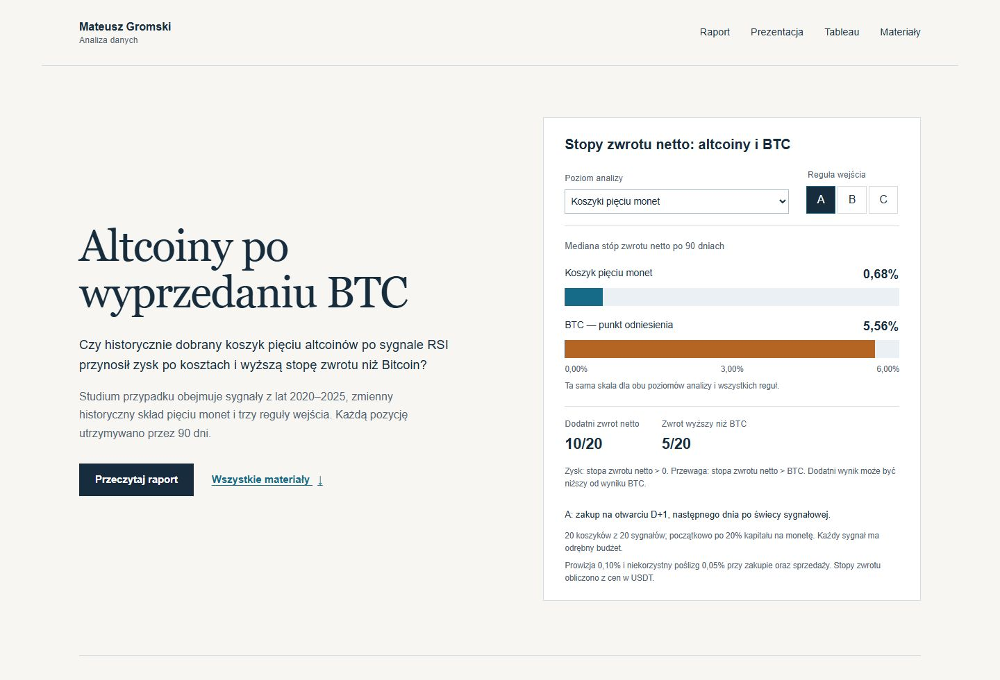

# Altcoiny po wyprzedaniu BTC: zysk, przewaga i ryzyko

**Mateusz Gromski · Portfolio analizy danych · Studium przypadku Google Data Analytics**

Czy zakup pięciu największych kwalifikujących się altcoinów po sygnale wyprzedania BTC przynosił zysk i był korzystniejszy niż zakup samego Bitcoina? Projekt porównuje historyczne wyniki z lat **2020–2025**. Skład koszyka dobierano osobno dla każdego sygnału, na podstawie wcześniejszego rankingu kapitalizacji.

**Najważniejszy wynik:** koszyki pięciu monet pokonały dopasowany BTC w **4–5 z 20 zdarzeń**, zależnie od reguły wejścia. Dodatnia stopa zwrotu nie wystarczała więc do uzyskania przewagi nad punktem odniesienia.

## Zobacz projekt

**[Otwórz interaktywne portfolio →](https://madridista011.github.io/altcoiny-btc-rsi-2020-2025/)** — raport, dashboardy i komplet materiałów do pobrania w jednym miejscu.

| Materiał | Co znajdziesz |
| --- | --- |
| **[Pełny raport PDF](raport/RAPORT.pdf)** | 27 stron: cel, dane, metodologia, wyniki, pięć wykresów i ograniczenia. |
| [Raport do czytania na GitHubie](raport/RAPORT.md) | Pełny tekst z tabelami i wykresami, bez pobierania pliku. |
| **[Dashboardy Tableau](tableau/Altcoiny_RSI_BTC.twbx)** | Dwa dashboardy, siedem wykresów i osadzone dane. [Instrukcja](tableau/INSTRUKCJA.md). |
| [Prezentacja projektu](prezentacja/Prezentacja.pptx) | Osiem slajdów, trzy edytowalne wykresy i notatki. [Podgląd slajdów](prezentacja/README.md). |
| [Tabele wynikowe](data/analysis) | Wyniki transakcji, koszyków, kosztów i obsunięcia kapitału w CSV. |
| **[Interaktywna strona projektu](https://madridista011.github.io/altcoiny-btc-rsi-2020-2025/)** | Porównanie reguł wejścia i wykres obsunięcia dla wybranego sygnału. [Uruchomienie lokalne](docs/ODTWORZENIE.md#interaktywna-strona-projektu). |



## Wyniki w skrócie

Wyniki koszyków dotyczą równych początkowych udziałów pięciu monet, po 20%. Każdy sygnał ma osobny budżet, a każdą inwestycję utrzymywano przez 90 dni.

| Reguła wejścia | Mediana zwrotu netto koszyka | Mediana zwrotu netto BTC | Koszyk z zyskiem | Koszyk lepszy od BTC |
| --- | ---: | ---: | ---: | ---: |
| A · następne otwarcie, D+1 | 0,68% | 5,56% | 10/20 | 5/20 |
| B · otwarcie D+7 | 1,76% | 4,93% | 11/20 | 4/20 |
| C · po powrocie RSI do ≥30 | 1,20% | 5,78% | 11/20 | 5/20 |

Mediany maksymalnego obsunięcia kapitału koszyków wyniosły od **−26,85% do −26,72%**, wobec **−20,93%** dla BTC. Najgłębsze obsunięcie koszyka w próbie wyniosło **−54,76%**. Są to miary osobnych 90-dniowych inwestycji, a nie ścieżka jednego konta za cały okres.

## Jak przeprowadzono analizę

1. Obliczono RSI(14) metodą Wildera na dziennych cenach BTC/USDT. Sygnał to przejście z wartości co najmniej 30 poniżej 30.
2. Dla każdego z 20 sygnałów wybrano pięć altcoinów z wcześniejszego rankingu. Wykluczono BTC, stablecoiny i tokeny opakowane. W badaniu pojawiło się 11 różnych monet, w tym SOL i XRP.
3. Porównano trzy reguły wejścia. W C wyszukiwano pierwszy powrót RSI do co najmniej 30 w dniach D+1–D+30, a zakup następował na kolejnym otwarciu.
4. Dla każdej pozycji dopasowano BTC z tej samej giełdy oraz identycznymi datami zakupu i sprzedaży. Uwzględniono 0,10% prowizji i 0,05% niekorzystnego poślizgu po każdej stronie transakcji.
5. Oceniono osobno zysk netto, przewagę nad BTC i jednoczesne spełnienie obu warunków. Sprawdzono integralność źródeł, obliczenia przepływów pieniężnych oraz miary ryzyka.

**Narzędzia:** Python, pandas, decimal, Matplotlib, Tableau Public, CSV i JSON. Analiza obejmuje **300 kompletnych porównań pojedynczych monet** oraz **60 koszyków**: 20 sygnałów × 3 reguły.

## Układ repozytorium

| Katalog | Zawartość |
| --- | --- |
| `raport/` | Pełny raport PDF i Markdown, rozdziały oraz pięć wykresów. |
| `prezentacja/` | Plik PowerPoint oraz obrazy wszystkich slajdów. |
| `tableau/` | Przenośny skoroszyt, instrukcja i tabele wejściowe. |
| `data/` | Dane źródłowe, przygotowane tabele, wyniki i manifesty pochodzenia. [Opis danych](data/README.md). |
| `scripts/` i `tests/` | Kod przygotowania, obliczeń, wykresów, strony oraz testy. |
| `config/` i `reports/` | Parametry badania i wyniki kontroli. |
| `docs/` | Metodologia, słowniki, źródła i instrukcja odtworzenia. |
| `web/` | Źródła interaktywnej strony projektu. |

## Odtworzenie wyników

Wymagany jest Python 3.12. W katalogu repozytorium uruchom:

```bash
python -m venv .venv
# Windows: .venv\Scripts\activate
# macOS / Linux: source .venv/bin/activate
python -m pip install -r requirements-plots.txt
python scripts/run_analysis.py
```

Polecenie wykorzystuje zachowane źródła, przelicza wyniki, uruchamia niezależne kontrole i testy oraz sprawdza zgodność z opublikowanymi CSV. Nie pobiera ponownie danych. Opcja `--full` odtwarza także wcześniejsze etapy przygotowania; opcja `--figures` eksportuje wykresy. [Szczegółowa instrukcja](docs/ODTWORZENIE.md).

## Granice interpretacji

Próba zawiera 20 powiązanych sygnałów i nakładające się okresy inwestycji. Rankingi poprzedzały sygnały o 1–5 dni, ale ich historyczne godziny publikacji pozostają niepotwierdzone. Ceny są w USDT; koszty i wykonanie transakcji są modelem. Dzienne dane nie pokazują wszystkich wahań wewnątrz dnia. Nie przeprowadzono formalnego testu istotności ani oceny horyzontów 30 i 180 dni. Wyniki opisują tę próbę i nie potwierdzają przyszłej skuteczności strategii.

**Źródła:** Binance Spot / Binance Vision, KuCoin oraz **Data: CryptWatch, based on CoinMarketCap**. Dane dostawców podlegają odrębnym warunkom wykorzystania; szczegóły w [rejestrze źródeł](docs/ZRODLA_DANYCH.md). Literatura metodyczna: Foster Provost i Tom Fawcett, *Analiza danych w biznesie. Sztuka podejmowania skutecznych decyzji*, Helion, 2014.
